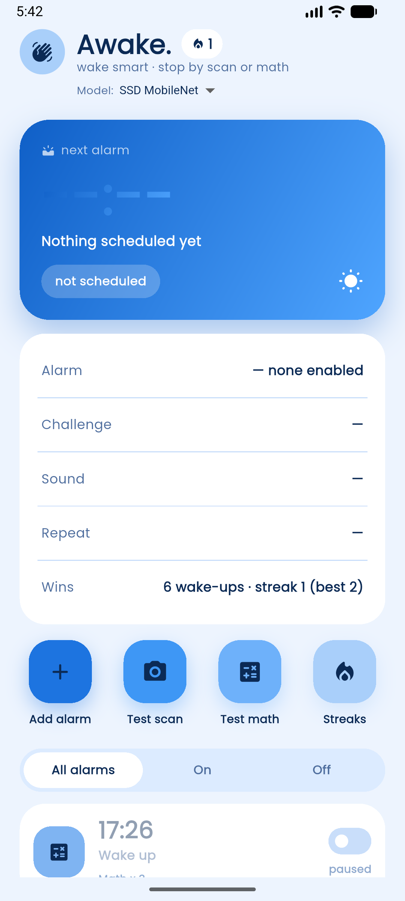
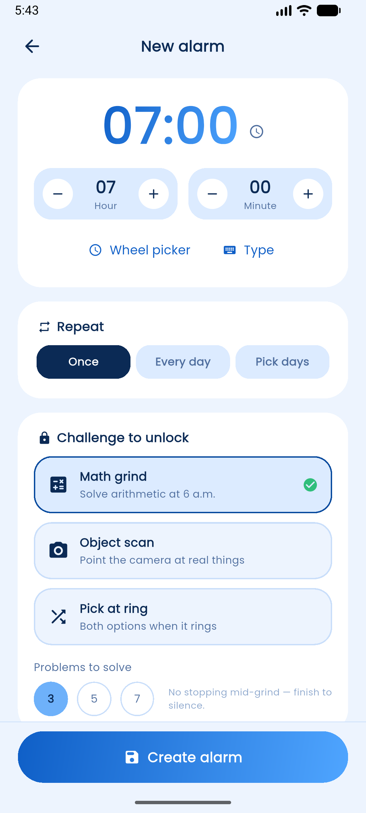
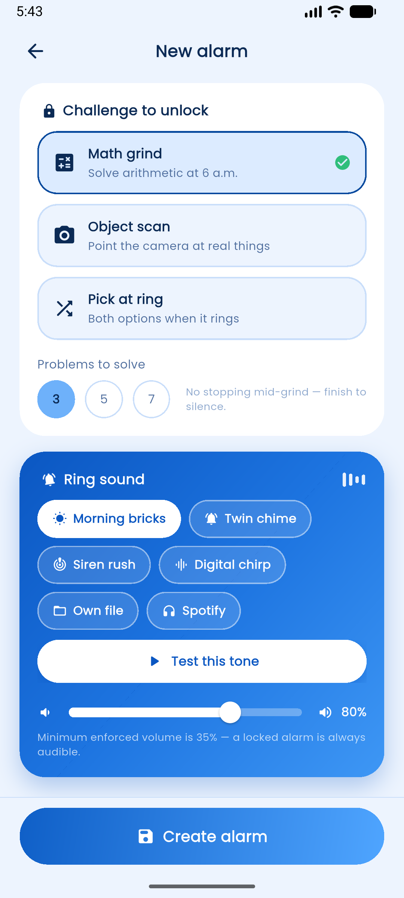

# awake - Non-Dismissable Alarm with On-Device ML Gate

⚠️ **Canonical evidence for the paper is tag `v1.1.1-paper`**; commits before 2026-11-07 are a stale snapshot.

**Version:** 1.1.0+4  
**Built:** Flutter 3.47.6 / Dart 3.13.5  
**Status:** Release build with two selectable on-device detectors, 78 unit tests, and an Android on-device model test.

---

## WHAT this is

An Android alarm clock that stops only after you complete a challenge: solve math problems or scan a real object with the camera. Detection runs on the phone with TensorFlow Lite. No camera frame or prediction leaves the device.

Two detectors are selectable on the home screen:

- **SSD MobileNet v1** - 80 named COCO classes, 300x300 uint8 input.
- **YOLO11n tuned** - five home-appliance classes, 416x416 float32 input.

The YOLO model is limited to microwave, oven, toaster, hair drier, and refrigerator. When it is selected, the editor and scan screen only offer those targets.

**Package:** `id.ac.bsi.awake`  
**App label:** `awake`  
**Installable release:** `dist/app-release-awake.apk`  
**Tests:** 78 pass  
**Coverage:** `coverage/lcov.info`  
**Tag:** `v1.1.1-paper`

---

## SCREENSHOTS







The 10-profile device matrix contact sheet is at
`screenshots/devices/contact_sheet.png`.

---

## HOW it works

```
User sets alarm (editor)
        |
        v
AlarmRepository (Dart) --------> Android exact alarm (RTC_WAKEUP)
        |                                    |
        v                                    v
SharedPreferences          Native foreground service (looping audio)
        |                                    |
        v                                    v
AwakeAlarm JSON            Full-screen ring intent
        |                                    |
        v                                    v
RingScreen --------------> MathGate OR ScanGate (SSD or YOLO TFLite)
        |                                    |
        v                                    v
Success --> Alarm.stop()   Stats update, streak++, alarm re-arms
```

**Key components:**

| File / Module | Role |
|---|---|
| `lib/main.dart` | App shell and ring router with replay for cold-start rings |
| `lib/core/palette.dart` | Design tokens: pale blue canvas, white cards, blue accents |
| `lib/core/widgets.dart` | Shared cards, pills, status rows, reveal animation |
| `lib/data/models.dart` | `AwakeAlarm`, `WakeStats`, scan target groups, COCO targets, `kYoloScanTargets` |
| `lib/data/alarm_repository.dart` | Native scheduling, boot recovery, one-shot retirement, repeating re-arm, tone fallback |
| `lib/data/math_engine.dart` | Non-negative integer problems at three difficulty tiers |
| `lib/data/coco_detector.dart` | SSD and YOLO loading, preprocessing, postprocessing, NMS, model switching |
| `lib/data/scan_geometry.dart` | Detector boxes projected onto the camera preview |
| `lib/data/tone_files.dart` | Durable copies of picked audio files and orphan cleanup |
| `lib/data/tone_preview.dart` | In-editor preview for built-in and file paths |

| `lib/screens/home_screen.dart` | Hero card, reliability card, alarm list, model picker, quick tiles |
| `lib/screens/editor_screen.dart` | Time, repeat, challenge, target, tone, and volume form |
| `lib/screens/ring_screen.dart` | Lockdown ring screen with back blocked |
| `lib/screens/math_challenge_screen.dart` | Custom keypad, progress chip, difficulty tag |
| `lib/screens/scan_challenge_screen.dart` | Camera preview, on-demand inference, hold meter, torch, shuffle |
| `lib/screens/success_screen.dart` | Celebration screen and trial-copy handling |

---

## HOW TO build, test, and install

```powershell
# 1. Dependencies
flutter pub get

# 2. Static analysis
flutter analyze

# 3. Unit and widget tests
flutter test

# 4. Debug APK
flutter build apk --debug

# 5. Release APK
flutter build apk --release

# 6. Install
adb install -r build\app\outputs\flutter-apk\app-release.apk
```

On this machine, Gradle must use the C drive because the old D drive is gone:

```powershell
$env:GRADLE_USER_HOME='C:\Users\BRAVO\.gradle'
flutter build apk --release
```

**Release artifact:** `dist/app-release-awake.apk`  
**Debug artifact:** `build/app/outputs/flutter-apk/app-debug.apk`

The release build is signed with the debug key so it can be installed without a private keystore. Replace the signing config before publishing to a store.

---

## Models and evaluation

| Model | Asset | Input | Output | Classes | Size |
|---|---|---|---|---|---|
| SSD MobileNet v1 | `assets/models/coco_ssd_mobilenet_v1_1.0_quant.tflite` | uint8 300x300x3 | 4 post-NMS tensors | 80 COCO | 4.0 MB |
| YOLO11n tuned | `assets/models/yolo11n_awake_appliance.tflite` | float32 416x416x3 | `[1, 9, 3549]` | 5 appliances | 2.9 MB |

Label maps:

- `assets/models/labels.txt` - 91 lines, index 0 is `???`, model class id is shifted by one.
- `assets/models/yolo_labels.txt` - direct five-class order: microwave, oven, toaster, hair drier, refrigerator.

### Held-out host evaluation

`tools/evaluate_detectors.py` evaluates 202 held-out COCO appliance images with the same center-cropped square frames the app uses. Full results are in `tools/results/detector_eval.json`.

| Model | mAP@0.5 | Gate recall @ 0.4 | @ 0.5 | @ 0.7 | Mean latency |
|---|---:|---:|---:|---:|---:|
| SSD MobileNet v1 | 0.1552 | 0.3343 | 0.2907 | 0.0901 | 25.4 ms |
| YOLO11n tuned | 0.2073 | 0.3227 | 0.3081 | 0.2587 | 63.5 ms |

The tuned YOLO model has higher mAP and much better high-confidence recall. SSD is faster. Both remain selectable because SSD covers many more object classes while YOLO is stronger on the five appliance targets.

### Android on-device test

`integration_test/detector_benchmark_test.dart` loads each model, warms it, and times 20 frames on the connected Android device. The test prints one JSON line per model. It runs both models on the same emulator used for the device matrix.

The earlier 90-class YOLO checkpoint was mislabeled and has been removed. Do not use its old metrics.

---

## 10-brand display matrix

`DEVICE_MATRIX_REPORT.md` records the 10-profile run. It covers Samsung, Google, Xiaomi, OnePlus, Oppo, Vivo, Huawei, Motorola, Sony, and Asus resolutions on one Android 17 emulator. It is a display and behavior matrix, not ten physical phones.

Reproduce:

```powershell
$env:GRADLE_USER_HOME='C:\Users\BRAVO\.gradle'
python tools\run_device_matrix.py
python tools\report_device_matrix.py
```

---

## Sound behavior

- Built-in tones are packaged WAV assets and loop through the native alarm service.
- A picked audio file is copied into the app documents directory as `tone_<timestamp>.<ext>`. The native service receives the absolute path and loops it. If the file disappears, scheduling falls back to the alarm's built-in tone so the alarm never becomes silent.

---

## TESTING verification

- `flutter analyze` reports zero issues.
- `flutter test` runs 78 tests across math, scan targets, geometry, detector postprocessing, and alarm models.
- The Android integration test passes both models on `emulator-5554`.
- The release APK is installed and launched at multiple resolutions without a crash.

Run the unit tests:

```powershell
flutter test
```

Run the Android model test (only when the test fixtures are present):

```powershell
$env:GRADLE_USER_HOME='C:\Users\BRAVO\.gradle'
flutter test integration_test\detector_benchmark_test.dart -d emulator-5554 `
  --dart-define=PROFILE=local --dart-define=BENCH_ITERS=20
```

The fixture images are not part of the shipped app. Add them to
`integration_test/fixtures/` and list that directory under `flutter.assets` in
`pubspec.yaml` before running the on-device test.

---

## KNOWN LIMITATIONS

- Scan gate with SSD covers 80 named COCO classes. Composites such as `glass` and `screen` use a synonym map.
- Scan gate with YOLO covers five appliance classes only.
- Detection quality in the dark, at extreme angles, or at long range is not guaranteed.
- A printed photo can satisfy the scan gate. This is intentional.
- A broken camera has no in-app escape for scan-only alarms. Use a math alarm or a mixed challenge.
- Force-stop cancels alarms until the app is opened again. Normal process death, reboot, and lock are handled.
- Some Xiaomi, Oppo, Vivo, and Huawei builds need autostart and battery optimization changes.

- The 10-brand test uses emulated display profiles. Only the Samsung physical-device delay result is user-reported.
- iOS is not configured.
- The release APK uses the debug signing key.

---

## PACKAGE AND VERSION

- Source version: `1.1.0+4`
- Package id: `id.ac.bsi.awake`
- Tag: `v1.1.1-paper` (canonical state for paper reproducibility)
- App label: `awake`
- Installable APK: `dist/app-release-awake.apk`
- Model evaluation: `tools/results/detector_eval.json`
- Device matrix: `tools/results/device_matrix.json`
- Device matrix report: `DEVICE_MATRIX_REPORT.md`
